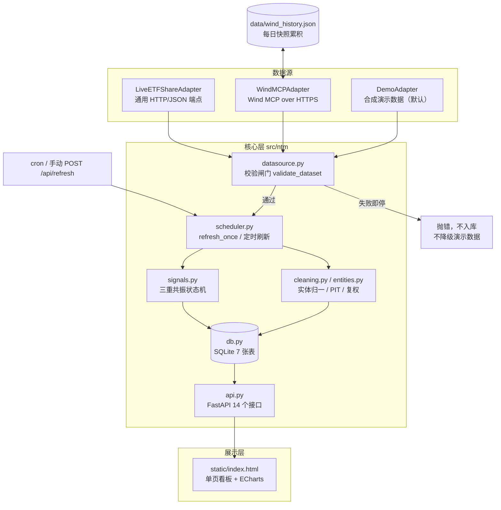

# 国家队资金三层监控看板 · 完整项目说明书

> **一句话**：用公开数据把「国家队是否在托底」拆成 **L1 实测 / L2 估算 / L3 代理**
> 三层，输出带置信度、明确标注「推断而非实锤」的**政策底概率信号**，
> 供人工判断进场环境。**不是跟单系统，不提供个股买卖建议。**

| 项目 | 值 |
|---|---|
| 项目名 | `national-team-monitor` |
| 版本 | `1.0.0` |
| 语言 / 运行时 | Python ≥ 3.10（开发验证于 3.11） |
| 许可证 | MIT |
| 测试 | **108 项 pytest 全绿** + `ntm check` 不变式自检 |
| 默认数据 | 合成演示数据（固定种子 `20261109`），全程标注 `is_demo` |
| 定位 | 研究 / 监控 / 复盘工具，**不构成投资建议** |

---

## 0. 文档导航

本仓库的文档按「读谁」分工，建议按此顺序阅读：

| 文档 | 内容 | 适合谁 |
|---|---|---|
| [`README.md`](../README.md) | 项目首页：快速开始、能力边界、目录、部署入口 | 所有人，先看 |
| **`docs/COMPLETE_GUIDE.md`（本文）** | **完整说明书**：方法论、架构、配置、API、数据接入、部署、运维、排错 | 要完整掌握项目的人 |
| [`docs/METHODOLOGY.md`](METHODOLOGY.md) | 方法论权威定义：三层模型、主体清单、术语、四条清洗规则、回测约束、真实数据核验清单 | 要改判定逻辑的人 |
| [`docs/DATA_DICTIONARY.md`](DATA_DICTIONARY.md) | 数据字典与 API 契约：7 张表字段、接口返回体、不变式 | 要接数据 / 对接前端的人 |
| [`docs/REFERENCE_STRATEGY.md`](REFERENCE_STRATEGY.md) | 用户原始策略材料原文存档 + 17 条逐项处置结论 | 要核对「为什么没实现某规则」的人 |
| [`docs/REVISED_PROMPT.md`](REVISED_PROMPT.md) | 开发提示词修订版（含原版问题逐条对照与验收标准） | 要复盘需求演进的人 |
| [`deploy/README.md`](../deploy/README.md) | 云服务器部署前置条件与回滚 | 运维 |
| [`SECURITY.md`](../SECURITY.md) | 凭据处理、密钥范围、漏洞报告 | 运维 / 贡献者 |

---

## 1. 项目定位与能力边界

### 1.1 为什么不是「跟单系统」

原始需求是「每天跟着国家队操作」。研判后确认这在公开数据下**物理不可行**：

- 国家队（中央汇金、证金、国新、诚通等）**没有日频交易流水披露**；
- ETF 一级市场申赎只公布**全市场总份额**，不公布申购人身份；
- 季报十大流通股东滞后 1–2 个季度，且「名单进出 ≠ 增减持」；
- 行情软件的「主力资金流入」「国家队席位」是推断指标，不是持仓事实。

因此系统重新定位为**分层监控 + 带置信度的概率推断**：可以回答
「当前是否具备政策底特征、值不值得进一步人工核查」，**不回答**
「国家队今天买了哪只股、我该买什么」。

### 1.2 能做什么 / 不能做什么

| 诉求 | 支持 | 说明 |
|---|---|---|
| 判断「是不是在托底、进场环境如何」 | ✅ | 三重共振 + 置信度 + 局限说明 |
| 季度复盘国家队持仓方向 | ✅ | L1 确权数据，带 PIT 时点防前视 |
| 观察宽基 ETF 每日份额与成交额 | ✅ | 7 只标的池、份额变化、放量倍数对照 |
| 每天知道国家队买了哪只股并照着买 | ❌ | 公开数据无此口径，系统明确不提供 |
| 个股买卖点、仓位、目标价、止损 | ❌ | 参考策略原文存档但**不实现**（合规） |
| 把「放量 2 倍」当作加仓信号 | ❌ | 成交额放量不改变份额，恒为非信号 |

### 1.3 四条铁律（代码与测试共同守护）

1. **所有信号 `is_confirmed = False`** —— 接入真实数据也不改变，份额无法归因。
2. **L2 只用 ETF 总份额 × 净值** —— 禁止用成交额、放量倍数、主力资金流入顶替 `total_share`。
3. **量能观测 `is_signal = False`** —— 不进入三重共振条件集合，输出不含买卖指令措辞。
4. **失败即停，绝不降级伪造** —— 真实数据源请求失败、字段缺失、日期不同步一律抛错，不回退演示数据、不写半份数据。

---

## 2. 核心方法论

### 2.1 三层数据模型

| 层 | 名称 | 数据 | 时滞 | 可归因 | 置信 | 关键限制 |
|---|---|---|---|---|---|---|
| **L1** | 实测（季度确权） | 十大流通股东、ETF 半年报/年报前十大持有人 | 滞后 1–2 季 | ✅ | high | 名单进出 ≠ 增减持；需复权与 PIT 处理 |
| **L2** | 估算（T+1） | 宽基 ETF 每日总份额变动 × 当日净值 | T+1 盘后 | ❌ | low | 仅代表全市场一级市场净申购，**无法识别申购人** |
| **L3** | 代理 / 交叉验证 | 央行、汇金、证监会、国资委、国新·诚通公告；互换便利、回购增持再贷款、融资余额、成交额 | T+0 ~ T+1 | ❌ | medium | 公告可确权「政策意图」但不含成交明细；额度 ≠ 实际买入金额 |

L2 是全系统最容易被误读的一层。看板与 API 对它统一附 `note: 估算·不可归因`。

### 2.2 三重共振与四种状态

判定条件（默认值，可用环境变量调整）：

| 条件 | 含义 | 默认阈值 |
|---|---|---|
| ① `market_drop` | 市场急跌（1 日 / 5 日跌幅） | `-1.5%` / `-4.0%` |
| ② `etf_sync` | 多只核心宽基 ETF 份额同步跳升 | ≥ `3` 只，合计净申购 ≥ `200` 亿元 |
| ③ `official` | 官方增持/稳市类公告配合 | 近 `5` 日内存在人工核验为 supportive 的公告 |

| 状态 | 触发 | 置信度 | 含义 |
|---|---|---|---|
| `POLICY_BOTTOM_PROBABLE` | ①②③ 全满足 | `medium` | 政策底信号（推断，非实锤） |
| `INFLOW_ONLY` | 仅 ② | `low` | 有大额增量资金承接，**不标记为国家队进场** |
| `ANNOUNCEMENT_ONLY` | 仅 ③ | `low` | 有政策意图，资金面未印证 |
| `NO_SIGNAL` | 全不满足 | `low` | 无托底信号 |

置信度上限为 `medium`，**不存在 `high`**——因为 L2 永远无法确权。

### 2.3 四条硬性清洗规则

1. **实体别名归一**：「中国证券金融股份有限公司 / 证金公司 / 中证金公司」收敛为同一实体 `csfc`，防止重复计数。
2. **排除非 A 股主体**：「中国投资有限责任公司」（中投，主权财富基金，主司境外投资）及其相关保护基金排除。
3. **PIT 防前视**：持仓记录以 `disclose_date`（真实披露日）而非 `report_period_end`（报告期末）生效，`effective_date` 不得晚于信号日。
4. **复权处理**：送转股导致的股数变化不得计为增持。

### 2.4 7 只宽基 ETF 标的池

| 代码 | 名称 | 交易所 | 2026 关注标记 |
|---|---|---|---|
| `510050` | 上证50ETF华夏 | 上交所 | — |
| `510300` | 沪深300ETF华泰柏瑞 | 上交所 | — |
| `510500` | 中证500ETF南方 | 上交所 | — |
| `512100` | 中证1000ETF南方 | 上交所 | — |
| `159845` | 中证1000ETF**华夏** | 深交所 | — |
| `588000` | 科创50ETF华夏 | 上交所 | ✅ |
| `159915` | 创业板ETF易方达 | 深交所 | ✅ |

材料原文把 `159845` 写成「易方达中证1000ETF」，已核实修正为**华夏中证1000ETF**（易方达那只代码为 `159633`）。
「持仓占比 20–40%」「2026 布局转向科创50/创业板」属**未确权观点**，仅作前端高亮，不参与任何计算。

### 2.5 量能观察层（为什么它不是信号）

系统计算成交额环比增量、环比增长率、`volume_multiple = 当日成交额 / 前 5 日均额`（阈值 2.0）。

> **关键口径**：成交额是**二级市场交易活跃度**，不改变 ETF 总份额，更无法识别买方身份。
> 「放量 2 倍」≠ 份额增加 ≠ 国家队加仓。演示数据专门内置了一个
> 「全部放量、份额变化近零」的反例日，用于直观验证这一点。

因此该层 `is_signal=False`、不进入三重共振条件集合、输出不含「买入/卖出/建仓/目标价」措辞。

### 2.6 参考策略存档

用户提供的三套监控方案、买入/卖出规则、仓位规则、复盘流程与风险提示，全部**原文存档**并逐条标注处置：

| 处置 | 条数 | 说明 |
|---|---|---|
| 已实现 | 8 | 标的池、量能观测、复盘流程、风险提示等客观能力 |
| 保留为参考 | 3 | 未确权观点、工具选型建议等 |
| **不实现（合规）** | 6 | 分批建仓、优先标的、卖出触发、目标价/止损等交易执行规则 |

理由：系统不提供个股买卖与择时建议。可用 `GET /api/reference/strategy` 查看逐条结论。

---

## 3. 系统架构

### 3.1 组件与数据流



**关键设计**：`db.save_dataset()` 是**全量替换**。Wind 适配器因此把每日快照累积在
`data/wind_history.json`，刷新时只补抓缺失交易日，避免清空历史序列导致图表与 5 日跌幅失效。

### 3.2 目录结构

```
national-team-monitor/
├── src/ntm/
│   ├── config.py            全局配置（全部可经环境变量覆盖；凭据只读环境变量）
│   ├── entities.py          主体清单 + 别名归一化（证金收敛、中投排除）
│   ├── etf_pool.py          7 只标的池、159845 修正、未确权观点隔离
│   ├── momentum.py          环比 / 放量倍数 / 量能汇总（纯函数，恒非信号）
│   ├── reference.py         参考策略原文存档与 17 条逐项处置
│   ├── layers.py            三层模型、术语表、陷阱与噪音清单
│   ├── cleaning.py          名单进出 / 复权 / PIT 防前视
│   ├── signals.py           三重共振状态机 + 未确权铁律
│   ├── datasource.py        真实数据集校验闸门 + /api/datasource 状态
│   ├── db.py                SQLite 存储与查询（含旧库自动迁移）
│   ├── backtest.py          防前视回测 + 基准对照
│   ├── alert.py             企业微信 / 邮件 / 站内预警（去重降噪、频率上限）
│   ├── scheduler.py         刷新编排、信号重算、快照累积
│   ├── api.py               FastAPI 接口 + 静态页挂载
│   ├── models.py            Pydantic 响应模型
│   ├── __main__.py          CLI 入口：init/refresh/serve/backtest/check
│   ├── adapters/
│   │   ├── base.py          FetchResult 数据契约
│   │   ├── demo.py          默认合成演示数据
│   │   ├── live.py          通用 HTTP 适配器（配置驱动，失败即停）
│   │   └── wind_mcp.py      Wind MCP 真实数据适配器（已实测核验）
│   └── static/index.html    单页看板（ECharts CDN，无需构建）
├── tests/                   108 项 pytest
├── docs/                    本文档 + 方法论 / 数据字典 / 参考策略 / 修订提示词
├── deploy/                  nginx.conf、ntm.service、crontab.example、deploy.sh、
│                            verified_announcements.example.json、README.md
├── scripts/                 push_github.sh / push_via_api.py / push_via_git.py /
│                            push_gitcode.py（GitCode / Gitee）
├── .github/workflows/ci.yml  CI：测试 + 自检 + 冒烟 + 镜像构建
├── .env.example             完整配置模板
├── Dockerfile / docker-compose.yml
├── Makefile / pyproject.toml / requirements.txt / LICENSE
└── README.md / SECURITY.md / CHANGELOG.md
```

### 3.3 技术栈与取舍

| 项 | 选择 | 理由 |
|---|---|---|
| 后端 | FastAPI + Uvicorn | 自带 OpenAPI 文档 `/docs`，轻量 |
| 存储 | SQLite（标准库 `sqlite3`） | 单机 MVP 免中间件；多实例写需迁 PostgreSQL/TimescaleDB |
| 调度 | 标准库线程 或 系统 cron | 不引入 APScheduler/Celery；**生产推荐 cron 调 HTTP API** |
| 前端 | 单页 HTML + ECharts CDN | 无构建链，静态目录直接 serve |
| 指标计算 | 标准库纯函数 | 逻辑简单、可单测，无需 Pandas |
| 测试 | pytest + FastAPI TestClient | 108 项，含契约与不变式 |

---

## 4. 快速开始

### 4.1 本地运行（3 条命令）

```bash
cd national-team-monitor
pip install -r requirements.txt
PYTHONPATH=src python3 -m ntm serve
```

打开 <http://localhost:8000>。首次启动自动建库并装载**演示数据**（页面顶部有醒目警示）。

也可安装为包后直接用 `ntm` 命令：

```bash
pip install .
ntm serve          # 等价于 python -m ntm serve
```

### 4.2 验证真的跑通

```bash
python3 -m pytest -q                 # 108 项测试
PYTHONPATH=src python3 -m ntm check # 不变式自检
curl http://localhost:8000/api/health
curl http://localhost:8000/api/datasource
```

`ntm check` 会校验 9 组不变式：证金别名收敛、中投排除、PIT 无前视、
`is_confirmed` 恒假、三层模型定义、历史信号一致、标的池 7 只且 159845 已修正、
量能观测中性且不出现交易措辞、演示数据不得被真实数据闸门误判为合规。

### 4.3 Makefile 快捷命令

| 命令 | 作用 |
|---|---|
| `make help` | 列出所有目标 |
| `make install` | 安装依赖 |
| `make test` | 跑测试 |
| `make check` | 不变式自检 |
| `make serve` | 启动服务 |
| `make refresh` | 刷新数据 |
| `make backtest` | 运行回测 |
| `make deploy` | 调用 `deploy/deploy.sh` |
| `make push` | 调用 `scripts/push_github.sh` |
| `make clean` | 清理构建产物 |

---

## 5. 配置参考

**全部配置走环境变量**，模板见 [`.env.example`](../.env.example)。
凭据只从环境变量读取，**不落盘、不打印、不进日志与报告**。

### 5.1 基础运行

| 变量 | 默认 | 说明 |
|---|---|---|
| `NTM_DEMO_MODE` | `1` | `1` 演示数据；`0` 启用真实适配器 |
| `NTM_DATA_DIR` | `./data` | 数据目录 |
| `NTM_DB_PATH` | `<DATA_DIR>/ntm.db` | SQLite 路径 |
| `NTM_HOST` | `0.0.0.0` | 监听地址 |
| `NTM_PORT` | `8000` | 端口 |
| `NTM_LOG_LEVEL` | `info` | 日志级别 |
| `NTM_ENABLE_SCHEDULER` | `1` | 应用内定时刷新线程开关；生产建议设 `0` 改用 cron |

### 5.2 信号判定阈值

| 变量 | 默认 | 说明 |
|---|---|---|
| `NTM_MARKET_DROP_1D` | `-1.5` | 条件① 单日跌幅（%） |
| `NTM_MARKET_DROP_5D` | `-4.0` | 条件① 5 日跌幅（%） |
| `NTM_ETF_SYNC_MIN` | `3` | 条件② 同步跳升的最少 ETF 只数 |
| `NTM_ETF_NET_MIN_YI` | `200` | 条件② 合计净申购下限（亿元） |
| `NTM_OFFICIAL_LOOKBACK` | `5` | 条件③ 公告回溯天数 |
| `NTM_REFRESH_HOUR` / `NTM_REFRESH_MINUTE` | `16` / `30` | 应用内调度器刷新时刻 |

### 5.3 预警

| 变量 | 默认 | 说明 |
|---|---|---|
| `NTM_WECHAT_WEBHOOK` | 空 | 企业微信机器人地址 |
| `NTM_SMTP_HOST` / `NTM_SMTP_TO` | 空 | 邮件预警 |
| `NTM_ALERT_MAX_PER_DAY` | `3` | 单日预警上限（降噪） |

### 5.4 量能观察

| 变量 | 默认 | 说明 |
|---|---|---|
| `NTM_VOLUME_SPIKE_MULTIPLE` | `2.0` | 放量倍数阈值 |
| `NTM_VOLUME_MA_WINDOW` | `5` | 均额窗口 |

### 5.5 真实数据源

| 变量 | 默认 | 说明 |
|---|---|---|
| `NTM_ENABLE_LIVE_ADAPTERS` | `0` | 总开关，必须与 `NTM_DEMO_MODE=0` 同时设置 |
| `NTM_DATA_SOURCE` | 空 | 空 = 通用 HTTP 适配器；`wind_mcp` = Wind MCP；`windpy` / `ifind` = 个人终端（见 PERSONAL_USAGE.md） |
| `NTM_DATA_ENDPOINT` | 空 | 数据源 HTTPS 端点 |
| `NTM_DATA_API_KEY` | 空 | 凭据（**仅环境变量**） |
| `NTM_DATA_VERIFIED` | `0` | 是否已完成核验清单并留档 |
| `NTM_DATA_TIMEOUT` | `10` | 请求超时（秒） |
| `NTM_DATA_MIN_INTERVAL` | `1.0` | 相邻请求最小间隔（秒，频控） |
| `NTM_WIND_BACKFILL_DAYS` | `12` | 单次刷新最多补抓交易日数（控制配额） |
| `NTM_WIND_KLINE_DAYS` | `120` | 指数 K 线回溯自然日数 |
| `NTM_WIND_TIMEOUT` | `25` | Wind MCP 单次请求超时（秒） |
| `NTM_WIND_MIN_INTERVAL` | `0.4` | Wind MCP 调用最小间隔（秒） |

---

## 6. 数据契约

### 6.1 数据库表（SQLite，7 张）

| 表 | 用途 | 关键字段 |
|---|---|---|
| `market_daily` | 市场日频（条件①、画图） | `date`, `close`, `pct_1d`, `pct_5d`, `amount_yi` |
| `etf_daily` | L2 份额 + 成交额 | `date`, `code`, `total_share`, `share_change`, `nav`, `est_net_yi`, `amount_yi`, `source` |
| `announcements` | L3 官方公告 | `date`, `source`, `title`, `is_supportive` |
| `holdings` | L1 季度持仓 | `report_period`, `report_period_end`, `disclose_date`, `effective_date`, `entity_id` |
| `signals` | 每日信号 | `date`, `state`, `confidence`, `is_confirmed`, `conditions` |
| `alerts` | 预警记录 | 去重与频控 |
| `meta` | 键值元数据 | `dataset_is_demo`, `dataset_source`, `dataset_as_of`, `data_latest_date` 等 |

`etf_daily.amount_yi` 由旧库自动 `ALTER TABLE` 迁移补列，无需手工处理。

### 6.2 API 接口（14 个）

所有 L2 响应带 `note: 估算·不可归因`；所有信号 `is_confirmed=false`。
交互式文档：服务启动后访问 `/docs`。

| 方法 | 路径 | 参数 | 返回 |
|---|---|---|---|
| GET | `/api/health` | — | 状态、版本、`is_demo` |
| GET | `/api/overview` | — | 最新信号 + 三层定义 + 免责声明 |
| GET | `/api/etf/shares` | `days=30` | ETF 份额时间序列 |
| GET | `/api/etf/pool` | — | 7 只标的池、未确权观点、校验结果 |
| GET | `/api/etf/momentum` | `day=YYYY-MM-DD` | 成交额/环比/放量倍数/份额对照，`is_signal=false` |
| GET | `/api/reference/strategy` | — | 参考策略原文 + 17 条处置结论 |
| GET | `/api/datasource` | — | 模式、各层记录数、字段契约、缺口、Wind 核查结论（**不返回任何凭据值**） |
| GET | `/api/signals` | `days=90` | 历史信号 |
| GET | `/api/announcements` | `limit=10` | 公告列表 |
| GET | `/api/holdings` | `limit=20` | 持仓列表 |
| GET | `/api/methodology` | — | 三层、术语、陷阱、噪音、主体清单 |
| GET | `/api/backtest` | `horizon=20` | 防前视回测结果 |
| GET | `/api/alerts` | — | 预警状态 |
| POST | `/api/refresh` | `as_of=YYYY-MM-DD` | 立即刷新并重算信号；并发时返回 409 |

静态页面挂载在 `/`（`StaticFiles(html=True)`），**必须最后挂载**以免覆盖 `/api/*`。

### 6.3 `/api/datasource` 关键字段

| 字段 | 含义 |
|---|---|
| `mode` | `demo` / `live` / `snapshot` |
| `is_demo` / `verified` | 是否演示数据、是否通过核验 |
| `dataset_as_of` / `data_latest_date` | 数据集基准日 / 份额最新日期 |
| `credential_configured` / `endpoint_configured` | **仅布尔值**，不泄露内容 |
| `layers[]` | 每层 `connected`、`records`、必需字段、缺口说明 |
| `wind_mcp` / `wind_alice_review` | Wind MCP 接入实况与外部数据源核查结论 |
| `gaps` / `iron_rules` | 接入缺口与四条铁律 |

三层卡片按**真实记录数**判定：即使切到真实数据，L1/L3 无记录仍显示「未接入」，
不会假装三层齐全。

---

## 7. 真实数据接入

### 7.1 前置核验（不可跳过）

按 [`docs/METHODOLOGY.md`](METHODOLOGY.md) 第八节逐项确认并留档：
授权与使用条款、字段含义与更新频率、历史回溯范围、频控与反爬、
主体账户名披露字符串清单、真实披露日抓取、交易日历、失败重试与幂等、
数据质量校验、归因边界。

未完成核验时 `NTM_DATA_VERIFIED=0`，系统拒绝启用真实源。

### 7.2 两种适配器

| 适配器 | 开关 | 状态 |
|---|---|---|
| `src/ntm/adapters/wind_mcp.py` | `NTM_DATA_SOURCE=wind_mcp` | 已实现并实测核验（L2 份额日频） |
| `src/ntm/adapters/live.py` | 留空 | 通用 HTTP/JSON 端点，配置驱动，由接入方按契约提供 |
| `src/ntm/adapters/windpy.py` | `NTM_DATA_SOURCE=windpy` | 本机 WindPy。字段名需超级命令确认。见 [`PERSONAL_USAGE.md`](../PERSONAL_USAGE.md) |
| `src/ntm/adapters/ifind.py` | `NTM_DATA_SOURCE=ifind` | iFinD 骨架。SDK / HTTP 解析未完成时失败即停 |

### 7.3 Wind MCP 字段映射

端点为 Wind MCP Streamable HTTP（无状态，`market_search_tools` 检索 +
`market_call_tool` 取数两步式元工具），凭据为 Wind 后台生成的长期 API Key。

| 工具 | 字段 | 映射到 |
|---|---|---|
| `get_index_kline` | 沪深300 日 K 收盘价、成交额 | `market_daily`（条件①、5 日跌幅、画图） |
| `fund_get_size` | 场内流通份额 `f_unit_floortrading`、当日份额变化 `f_unit_floortradingchange`、份额变动日期 `f_unit_changedate` | **`total_share` / `share_change`（L2 核心）**，日频且可按 `asOfDate` 回溯 |
| `fund_get_listed_historical_price` | IOPV `f_nav_iopv`、成交额 `f_dq_amount` | `nav` / `amount_yi`（量能观测） |

**绝不用成交额或资金流顶替份额。** 数据链路：

```
Wind MCP → 解析 SSE 响应 → 组装四层 dataset
   → validate_dataset 闸门（拒绝 demo 标记 / 未来日期 / PIT 前视 / attributable=true）
   → SQLite 全量替换 → 重算信号 → /api/* → 前端
```

### 7.4 两个必须知道的时滞与实现约束

1. **ETF 份额是 T+1 日频，不是逐笔实时。** 盘中查询时 Wind 会把份额变动日期回退到上一交易日、当日变化为 `--`。适配器识别为「尚未发布」并**跳过该日**，各层统一截到最新份额日，绝不拿旧数据冒充当日，也不把「今天盘中指数 + 昨天份额」混算信号。
2. **定时刷新必须走 HTTP API，不能直接跑 CLI**：cron 不加载 `.env`，直接执行 `ntm refresh` 会丢失凭据并触发「失败即停」。

推荐安装 [`deploy/crontab.example`](../deploy/crontab.example) 到 `/etc/cron.d/ntm-refresh`：

```cron
# 每交易日 16:30（周一至周五），POST /api/refresh
30 16 * * 1-5  curl -fsS -X POST http://127.0.0.1:8000/api/refresh >> /var/log/ntm-refresh.log
```

随时可手动触发：

```bash
curl -X POST http://127.0.0.1:8000/api/refresh
curl -X POST "http://127.0.0.1:8000/api/refresh?as_of=2026-11-09"
```

### 7.5 数据源契约与失败即停

任何适配器都必须一次性返回 `market / etf / announcements / holdings` 四层，
`etf` 必须含 **`total_share` 与 `nav`**。校验闸门会拒绝：

- 用成交额、放量倍数、主力资金流入顶替 `total_share`；
- 带 demo 来源标记的数据集；
- 未来日期 / PIT 前视；
- `attributable=True` 的 L2 记录。

请求失败、字段缺失、日期不同步 → 抛错停止，**不入库、不降级演示数据、不写半份数据**。

### 7.6 仍然缺的两层（系统不伪造）

- **L1 季度十大流通股东**：Wind MCP 无对应明细工具，保持空列表并在看板标注缺口。
- **L3 官方公告**：**不自动确权**。仅从 `data/verified_announcements.json`
  读取人工核验记录（格式见
  [`deploy/verified_announcements.example.json`](../deploy/verified_announcements.example.json)）；
  文件不存在即为空数组，`is_supportive` 只能由人工核对官方原文后填写。
  文件为空时三重共振的「官方」条件不触发——这是刻意的安全设计。

> 即使全部接上，**份额变化依然无法归因到国家队**，`is_confirmed` 恒为 `False`。
> 接真实数据 ≠ 能跟单。

---

## 8. 部署

### 8.1 方式 A：本地 / 单机直接跑

见「快速开始」。适合开发与验证。

### 8.2 方式 B：Docker Compose（推荐自建）

```bash
cp .env.example .env
docker compose up -d --build
curl http://localhost:8000/api/health
```

数据卷 `ntm-data` 持久化 SQLite；镜像以非 root 用户运行，含 HEALTHCHECK。

### 8.3 方式 C：Python venv + systemd + Nginx（无 Docker 环境）

适合已有业务、不便安装 Docker 的主机。要点：

1. 打包源码上传至 `/opt/national-team-monitor`，创建专用系统用户（非 root）；
2. 建立 venv 并 `pip install .`；
3. `ntm init` + 首次 `POST /api/refresh` 灌数据，`ntm check` 自检；
4. 使用 [`deploy/ntm.service`](../deploy/ntm.service)，通过 `EnvironmentFile` 注入 `.env`（权限 `640 root:<运行用户>`）；
5. 应用只监听 `127.0.0.1:8000`，由 Nginx 反代 80/443；
6. **新增独立站点文件，不改动任何现有 Nginx 配置**，避免影响同机其他业务；
7. 安装 [`deploy/crontab.example`](../deploy/crontab.example) 做盘后刷新。

一键脚本（需自备 SSH 凭据，仓库不含任何主机凭据）：

```bash
export SERVER_HOST="<你的服务器 IP 或域名>"
export SERVER_USER="root"
export SSH_KEY="$HOME/.ssh/id_rsa"   # 可选
export DOMAIN=""                      # 可选，配置后启用 Nginx
./deploy/deploy.sh
```

脚本逐步校验，健康检查通过后才输出真实访问地址；失败保留上一版本并给出回滚命令。

### 8.4 方式 D：代码托管

本仓库可推送到 GitHub（classic PAT 走 `scripts/push_github.sh`）、
GitCode / Gitee（`scripts/push_gitcode.py`），也可自建 Gitea 等 Git 服务。
见 [`SECURITY.md`](../SECURITY.md) 关于凭据与公开仓库的注意事项。

### 8.5 生产检查清单

| 项 | 建议 |
|---|---|
| `NTM_DEMO_MODE` | 接真实数据后设 `0`，并完成核验清单 |
| `NTM_ENABLE_SCHEDULER` | 设 `0`，改用 cron 调 `/api/refresh` |
| 凭据 | 仅在服务端 `.env` / 环境变量，权限 `640`，不进版本库 |
| CORS | `api.py` 默认 `*`，生产收敛到具体域名 |
| 8000 端口 | 只绑定 `127.0.0.1`，由 Nginx 反代，不直接暴露公网 |
| HTTPS | 有域名后配置证书；纯 IP 的 HTTP 明文访问不适合传凭据 |
| 备份 | 定期备份 `data/ntm.db` 与 `data/wind_history.json` |
| 时区 | 服务器需为 `Asia/Shanghai`（CST），否则盘后刷新错位 8 小时 |

---

## 9. 运维手册

### 9.1 常用命令

```bash
# 服务
systemctl status ntm.service
systemctl restart ntm.service
journalctl -u ntm.service -f

# 自检与测试
cd /opt/national-team-monitor
.venv/bin/python -m ntm check
.venv/bin/python -m pytest -q

# 数据
curl -s http://127.0.0.1:8000/api/datasource | python3 -m json.tool
curl -s http://127.0.0.1:8000/api/overview   | python3 -m json.tool
curl -X POST http://127.0.0.1:8000/api/refresh
cat data/refresh.log

# Nginx
nginx -t && systemctl reload nginx
```

### 9.2 故障排查

| 现象 | 原因 | 处理 |
|---|---|---|
| `POST /api/refresh` 返回 500 | 「失败即停」闸门按设计触发（当日份额 T+1 未发布 / 字段缺失 / 日期不同步） | 查服务日志确认缺失字段；属正常时滞则等盘后再刷，**不要关闭闸门** |
| 定时刷新丢凭据 | cron 直接跑 CLI，未加载 `.env` | 改为 `curl -X POST /api/refresh` |
| 刷新后历史图表变空 | `save_dataset` 全量替换，只取当日会清空历史 | 确认 `data/wind_history.json` 存在且适配器补抓了历史交易日 |
| 看板显示「演示数据」但已配真实源 | `.env` 未生效或 `NTM_DEMO_MODE` 仍为 `1` | 检查 systemd `EnvironmentFile`、重启服务、查 `/api/datasource` |
| `/api/datasource` 显示 L1/L3 未接入 | 数据源物理不提供 / 人工确权文件为空 | 属预期行为，系统不伪造；按 7.6 补齐 |
| 刷新时间错位 8 小时 | 服务器时区为 UTC | `timedatectl set-timezone Asia/Shanghai` |
| `git push` 403 | 令牌缺 `contents=write`（常见于 `ghu_` App 令牌） | 改用具备 `repo` 权限的 classic PAT |

---

## 10. 测试与质量保障

**108 项 pytest**，覆盖：

- 实体别名收敛（证金）、中投排除、名单进出不可判定、送转股复权、PIT 前视检测；
- 三重共振四种状态、`is_confirmed` 恒假、置信度上限、演示数据可复现；
- API 契约、刷新链路、回测 PIT 校验；
- 标的池 7 只与 `159845` 修正、交易所前缀匹配、未确权观点隔离；
- 放量倍数 / 环比纯函数、量能观测恒非信号、文案无交易指令措辞、量能不污染条件集合；
- 真实数据闸门（拒绝顶替字段 / demo 标记 / 未来日期 / 可归因标记）；
- Wind MCP 适配器（SSE 中文解码、字段映射、T+1 跳过、历史回溯、日期对齐）。

CI（[`.github/workflows/ci.yml`](../.github/workflows/ci.yml)）包含两个作业：
**测试与自检**（安装依赖 → 单元测试 → `ntm check` → 启动服务冒烟访问健康接口）
与**镜像构建**（`docker build`）。

```bash
python3 -m pytest -q
PYTHONPATH=src python3 -m ntm check
python3 -m compileall -q src tests
```

---

## 11. 合规、边界与免责

### 11.1 明确排除的数据与口径

- 行情软件「主力资金流入 / 国家队资金流向」指标；
- 龙虎榜所谓「国家队席位」、网传「今日买入清单」；
- 「多只 ETF 放量 2 倍 = 国家队加仓/减仓」这类组合误读；
- 任何个股买卖、仓位、目标价、止损、择时输出。

### 11.2 已知限制

| 限制 | 说明 |
|---|---|
| 演示数据 | 合成数据，不可用于实盘决策 |
| 交易日历 | 仅判周末，节假日需接入交易所日历 |
| SQLite | 单实例写，多实例需迁 PostgreSQL/TimescaleDB |
| 回测 | 未做撮合级模拟（滑点 / 涨跌停 / 停牌） |
| 样本量 | 国家队进场事件历史上为个位数，统计结论极易过拟合 |
| 成交额 | 放量倍数仅供观测，不升级为信号 |
| 未确权观点 | 「持仓占比 20–40%」「2026 布局转向」无日频公开口径，只作参考 |
| 商业数据 | 万得 / 同花顺申赎明细与推送需账号授权与合规核验 |
| CORS | 默认 `*`，生产请收敛到具体域名 |
| 政策底 ≠ 市场底 | 历史间隔 40 天至 6 个月 |

### 11.3 免责声明

> ⚠️ 本系统所有「国家队资金」判断均为基于公开数据的**概率推断，无法确权**；
> L2 仅代表全市场一级市场净申购、无法识别申购人。系统**不提供任何个股买卖建议**，
> 不构成投资建议或择时建议。政策底不等于市场底。市场有风险，投资需谨慎，
> 决策与风险由使用者自行承担。

---

## 12. FAQ

**Q：接入真实数据后能跟着国家队买了吗？**
不能。份额数据不含申购人身份，`is_confirmed` 恒为 `False`。真实数据只让 L2 估算更准确，
不改变归因边界。

**Q：为什么「放量 2 倍」不算信号？**
成交额是二级市场交易活跃度，不改变 ETF 总份额。它可以是任何资金的对倒、调仓或套利，
与一级市场申购无必然关系。看板把成交额与份额变化分列对照，并提供「全部放量、份额近零变化」的反例日。

**Q：为什么 L1 / L3 一直显示未接入？**
L1 需要季度十大流通股东明细、L3 需要官方公告人工核验，公开接口没有可靠自动通道。
系统按真实记录数判定并显式标注缺口，不用「切了真实数据」来假装三层齐全。

**Q：可以直接改 `is_supportive=true` 让信号触发吗？**
字段设计上允许人工录入，但**必须由人核对官方原文后填写**。系统不根据标题或新闻自动推断，
这是防止新闻误触发三重共振的安全设计。

**Q：演示数据的日期为什么是 2026-11-09？**
固定种子的合成数据，用于可复现的演示与测试。切真实数据后以数据源返回的份额变动日期为准。

**Q：如何迁移到自己的数据源？**
实现 `src/ntm/adapters/base.py` 的 `FetchResult` 契约，或配置通用 HTTP 端点，
完成核验清单后设置 `NTM_DATA_*` 环境变量。校验闸门会自动拒绝不合规数据集。

---

## 13. 版本与许可

- 版本：`1.0.0`，变更记录见 [`CHANGELOG.md`](../CHANGELOG.md)
- 许可：MIT，见 [`LICENSE`](../LICENSE)
- 安全与凭据处理：见 [`SECURITY.md`](../SECURITY.md)
